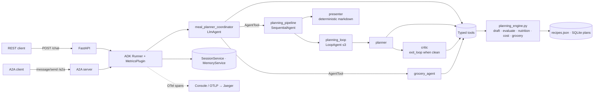

# 🥦 Veggie Meal Planner — a vegetarian meal-planning agent on Google ADK

[](https://github.com/srishtii1/veggie-meal-planner/actions/workflows/ci.yml)


A multi-agent assistant that builds weekly **vegetarian** meal plans, respects allergies,
diets (vegan, Jain, eggless, low-FODMAP…), prep-time limits, pantry contents and budget,
then produces an aisle-grouped grocery list. Vegetarian compliance is enforced in code,
not by prompting — the model physically cannot add meat.

Interfaces: **REST** (`POST /chat`), **A2A** (`/a2a`), and the **ADK dev UI** (`adk web`).

---

## Quick start

```bash
git clone https://github.com/srishtii1/veggie-meal-planner && cd veggie-meal-planner
uv sync --all-groups                      # Python 3.12, pinned lockfile
cp .env.example .env                      # add GOOGLE_API_KEY from https://aistudio.google.com/apikey

make test                                 # 100+ tests, fake model, no network, ~3 s
make playground                           # ADK dev UI  -> http://localhost:8000
make backend                              # REST + A2A  -> http://localhost:8080/docs
```

Try it:

```bash
curl -s localhost:8080/chat -H 'content-type: application/json' \
  -d '{"message":"We are 2 vegans with a nut allergy. Plan 5 days of lunch and dinner under $60.","user_id":"me"}' | jq .reply -r
```

Human-in-the-loop — some actions come back as *pending* and only run after approval:

```bash
# 1. ask for a change; the response lists pending_confirmations and nothing has changed yet
curl -s localhost:8080/chat -H 'content-type: application/json' \
  -d '{"message":"Swap Tuesday dinner for something faster","user_id":"me","session_id":"<sid>"}' \
  | jq '.pending_confirmations'
# 2. approve (or "approved": false to reject)
curl -s localhost:8080/chat/confirm -H 'content-type: application/json' \
  -d '{"user_id":"me","session_id":"<sid>","confirmation_id":"<id>","approved":true}' | jq .reply -r
```

Docker (with Jaeger for traces at http://localhost:16686):

```bash
docker compose up --build
```

## What it does

| # | Use case | How |
|---|---|---|
| 1 | Weekly plan generation (N days × breakfast/lunch/dinner/snack) | `draft_meal_plan` — deterministic, variety-aware, cuisine-rotating |
| 2 | Dietary sub-constraints: vegan, lacto, ovo, Jain, gluten/nut/soy/sesame/dairy/egg-free, low-FODMAP | Hard filters in the recipe catalog; allergens are never soft |
| 3 | Nutrition targets (kcal / protein per day) with protein-light-day warnings | `compute_nutrition`, critic flags days under target |
| 4 | Pantry-aware planning | Ranking boosts recipes using what you have |
| 5 | Grocery list: aggregated, scaled by servings, pantry subtracted, grouped by aisle | `build_grocery_list` via the `grocery_agent` |
| 6 | Swap / regenerate a single meal ("Tuesday dinner, faster") | `swap_meal` with `max_prep_time_min` |
| 7 | Leftover & batch-cook logic (cook once, eat twice), weekday vs weekend prep limits | `batch_friendly` dinners become next-day lunches |
| 8 | Budget cap | Greedy cheaper-swap pass + `estimate_cost` |
| 9 | Preference memory across sessions | `user:` state prefix persisted by `DatabaseSessionService`; `load_memory` for recall |
| 10 | Feedback loop (rate 1–5; 1 = banned) | `rate_meal` feeds the ranking |
| 11 | **Vegetarian enforcement** | Deny-list validator at catalog load, in `before_tool_callback`, in `before_model_callback`, and in the critic |
| 12 | Medical / nutrition disclaimer | Policy block shared by every agent prompt |
| 13 | Clarify before guessing | Tools report `missing_essentials`; `draft_meal_plan` refuses without a household size |
| 14 | **Human-in-the-loop approval** | Plan edits, permanent bans and loosening allergies/diet pause for the user (`POST /chat/confirm`) |
| 15 | **Privacy** | PII (emails, phones, cards, addresses, API keys…) redacted from logs, traces and long-term memory |

## Architecture



Read [ARCHITECTURE.md](ARCHITECTURE.md) for the design rationale, the reasoning loop, state
layout and the trade-offs taken.

### How it maps to the rubric

| Area | Where to look |
|---|---|
| **Tool & interface design** | [`tools/`](src/veggie_planner/tools) — 14 typed, idempotent tools returning `{"status", ...}`; [`api/app.py`](src/veggie_planner/api/app.py) REST + OpenAPI; A2A Agent Card at `/a2a/.well-known/agent-card.json` |
| **Context & memory** | [`memory/services.py`](src/veggie_planner/memory/services.py) (in-memory / SQLite / Vertex), `user:` / session / `temp:` state prefixes in [`tools/profile.py`](src/veggie_planner/tools/profile.py), compact `Recipe.summary()` so full recipe bodies never enter the prompt; memory ingestion runs as a FastAPI **background task** on a PII-redacted copy of the session (`persist_memory` in [`api/app.py`](src/veggie_planner/api/app.py)) |
| **Orchestration & logic** | [`agents/agent.py`](src/veggie_planner/agents/agent.py) coordinator → `SequentialAgent(LoopAgent(planner, critic), presenter)`, separate `VMP_PLANNER_MODEL` routing; guardrails in [`agents/callbacks.py`](src/veggie_planner/agents/callbacks.py); **human-in-the-loop** confirmation policies in [`agents/confirmation.py`](src/veggie_planner/agents/confirmation.py) (ADK `require_confirmation`, `POST /chat/confirm`); deterministic core in [`planning_engine.py`](src/veggie_planner/planning_engine.py) |
| **Observability & tracing** | [`observability/`](src/veggie_planner/observability) — OTel tracer/meter providers, ADK built-in spans (`invoke_agent`, `call_llm`, `execute_tool`), custom request span; **pre-execution `tool.intent` audit log + span event** for every attempted tool call ([`audit.py`](src/veggie_planner/observability/audit.py)); `MetricsPlugin` (tokens, latency, tool outcomes, guardrail blocks, confirmation decisions); **PII redaction** of logs, spans and memory ([`redaction.py`](src/veggie_planner/observability/redaction.py)); structlog JSON with `trace_id`, `GET /metrics`, Jaeger in `docker-compose.yml` |
| **Infrastructure & CI/CD** | `uv.lock`, multi-stage non-root [`Dockerfile`](Dockerfile), [`ci.yml`](.github/workflows/ci.yml) lint→mypy strict→tests (3.12/3.13)→image build+smoke, [`release.yml`](.github/workflows/release.yml) → GHCR, manual [`deploy.yml`](.github/workflows/deploy.yml) → Vertex AI Agent Engine, Dependabot, pre-commit |

## Repository layout

```
src/veggie_planner/
├── agent.py            # root_agent for the adk CLI
├── agents/             # coordinator, planner, critic, presenter, prompts, callbacks
├── tools/              # profile, recipes, planning, grocery tools (typed, tested)
├── guardrails/         # vegetarian deny-list validator (framework-free)
├── planning_engine.py  # deterministic draft / evaluate / nutrition / cost / grocery
├── data/               # recipes.json (65 vegetarian recipes) + catalog loader
├── storage.py          # SQLite plan store
├── memory/             # session + memory service factories
├── observability/      # OTel, structlog, MetricsPlugin, tool-intent audit, PII redaction
├── api/                # FastAPI app, schemas, A2A mount
└── config.py           # VMP_* settings
tests/                  # unit (tools, engine, guardrails, agents) · integration (REST, A2A) · evals
deployment/             # Agent Engine deploy script
```

## Configuration

| Variable | Default | Purpose |
|---|---|---|
| `GOOGLE_API_KEY` / `GOOGLE_GENAI_USE_VERTEXAI` | — | Gemini via AI Studio (`FALSE`) or Vertex (`TRUE`) |
| `VMP_MODEL` | `gemini-3.5-flash` | Model for all agents (`VMP_PLANNER_MODEL` overrides the planner) |
| `VMP_SESSION_BACKEND` | `sqlite` | `memory` · `sqlite` · `vertex` |
| `VMP_DB_URL` | `sqlite+aiosqlite:///./data/veggie_planner.db` | ADK session DB |
| `VMP_MAX_LOOP_ITERATIONS` | `3` | Draft → critique → fix rounds |
| `OTEL_EXPORTER_OTLP_ENDPOINT` | unset | Send traces/metrics to an OTLP collector (Jaeger) |
| `VMP_TRACE_CONSOLE` | `false` | Print spans/metrics to stderr (handy without Jaeger) |
| `VMP_REQUIRE_CONFIRMATION` | `true` | Human approval for plan edits, bans and loosening constraints |
| `VMP_REDACT_PII` | `true` | Scrub PII from logs, exported spans and memory |
| `VMP_CAPTURE_CONTENT_IN_SPANS` | `false` | Let ADK put prompts/responses in span attributes (still redacted) |

## Testing & evals

```bash
make lint typecheck test      # ruff, mypy --strict, pytest (fake model)
make cov                      # coverage report (≈90 %)
make eval                     # adk eval with tests/evals/*.evalset.json (needs a real key)
```

The test suite drives the whole agent tree with a scripted fake `BaseLlm`, so it verifies
tool trajectories, state propagation (`user:profile`, `current_plan_id`), the critic→fix
iteration, guardrail refusals, OTel spans, the REST contract and the A2A JSON-RPC flow —
all offline.

## Deploy

- **Container**: `docker build -t veggie-meal-planner . && docker run -p 8080:8080 --env-file .env veggie-meal-planner`
- **Cloud Run**: deploy the image; set `VMP_SESSION_BACKEND=sqlite` with a mounted volume, or `vertex`.
- **Vertex AI Agent Engine**: `make deploy-agent-engine` (or the manual *Deploy* workflow). Uses managed sessions and Memory Bank.

## Limitations / honest notes

- 65 seed recipes; Jain + low-FODMAP combinations are thin and the planner says so.
- Cost estimates are rough per-serving constants, not live prices.
- No auth on the REST API — front it with IAP or a gateway before exposing it.
- `LoopAgent`/`SequentialAgent` are deprecated in favour of ADK `Workflow`, but a `Workflow`
  cannot yet be an `AgentTool`/sub-agent, which this design needs (see ARCHITECTURE.md).

## License

MIT — see [LICENSE](LICENSE).
